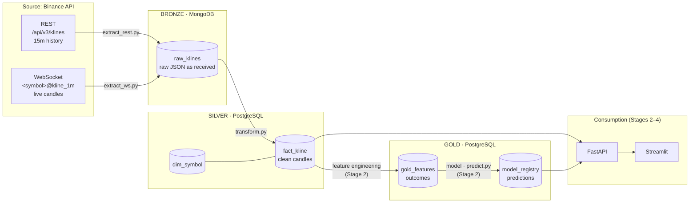
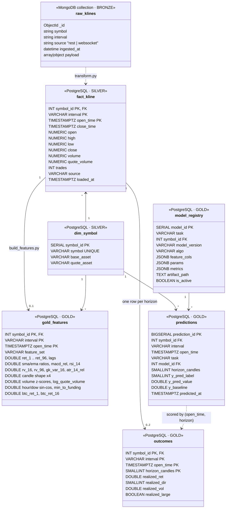

# Architecture

## 1. Data flow (medallion architecture)

| Layer | Storage | Content | Why this storage |
|---|---|---|---|
| Bronze | MongoDB `raw_klines` | Raw Binance responses, unchanged, plus `symbol`, `interval`, `source`, `ingested_at` | Schema-less: REST (array) and WebSocket (object) payloads have different shapes; keeping the original allows reprocessing without re-downloading |
| Silver | PostgreSQL `fact_kline`, `dim_symbol` | Typed, deduplicated candles in one structure for all symbols | Fixed schema, primary key prevents duplicates, joins and SQL aggregations |
| Gold | PostgreSQL `gold_features`, `outcomes`, `model_registry`, `predictions` | Model features, realized targets, trained models and their predictions | Ready-to-serve tables read by FastAPI and Streamlit |

## 2. Data model (UML class diagram)

**How the data sets are linked**
- Bronze and silver are linked by the business key `(symbol, interval, open_time)`; `transform.py` maps `symbol` to `dim_symbol.symbol_id`.
- In Postgres, every table references `dim_symbol` through `symbol_id`, so adding a new trading pair is one row in `dim_symbol`.
- `fact_kline` and `gold_features` share the primary key `(symbol_id, interval, open_time)`: one feature row per candle.
- `outcomes` holds what really happened after each candle, per horizon (1 candle, 4 candles). It is built from `fact_kline` only, so it serves both as the training target and as the truth that predictions are scored against.
- `predictions` is one long table for all models: a row is `(candle, task, model_id)`. A new model is a new `task` value and a row in `model_registry`, not a new table. `model_registry` keeps metrics, parameters and the feature list of every trained model; exactly one model per task and symbol is `is_active`.
