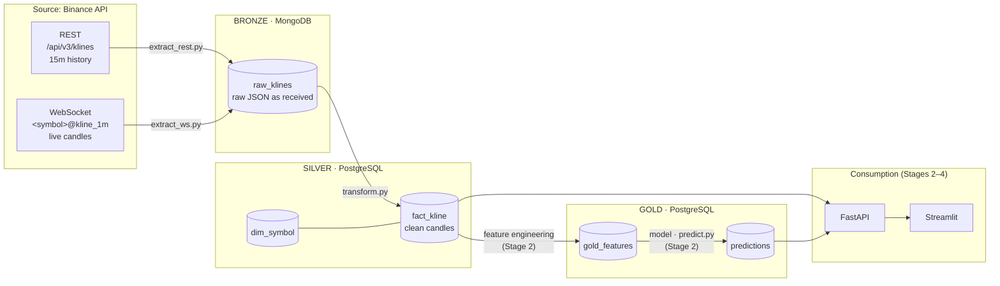
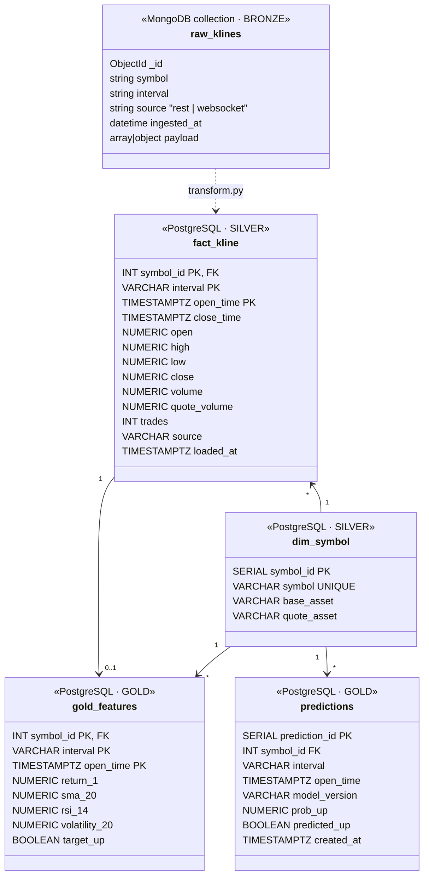

# Architecture

## 1. Data flow (medallion architecture)

| Layer | Storage | Content | Why this storage |
|---|---|---|---|
| Bronze | MongoDB `raw_klines` | Raw Binance responses, unchanged, plus `symbol`, `interval`, `source`, `ingested_at` | Schema-less: REST (array) and WebSocket (object) payloads have different shapes; keeping the original allows reprocessing without re-downloading |
| Silver | PostgreSQL `fact_kline`, `dim_symbol` | Typed, deduplicated candles in one structure for all symbols | Fixed schema, primary key prevents duplicates, joins and SQL aggregations |
| Gold | PostgreSQL `gold_features`, `predictions` | Model features and predictions | Ready-to-serve tables read by FastAPI and Streamlit |

## 2. Data model (UML class diagram)

**How the data sets are linked**
- Bronze and silver are linked by the business key `(symbol, interval, open_time)`; `transform.py` maps `symbol` to `dim_symbol.symbol_id`.
- In Postgres, every table references `dim_symbol` through `symbol_id`, so adding a new trading pair is one row in `dim_symbol`.
- `fact_kline` and `gold_features` share the primary key `(symbol_id, interval, open_time)`: one feature row per candle.
- `predictions` keeps every model run (`model_version`, `created_at`), so predictions can be compared with the real outcome later.
