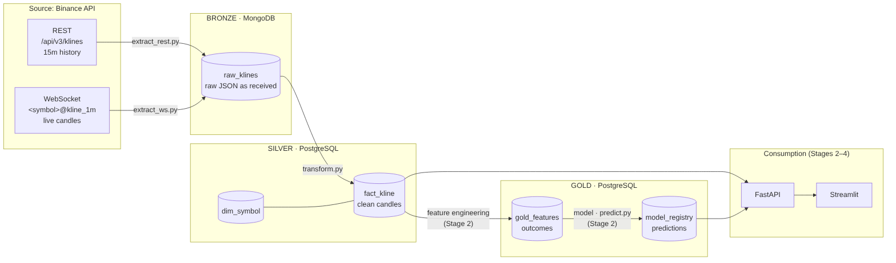
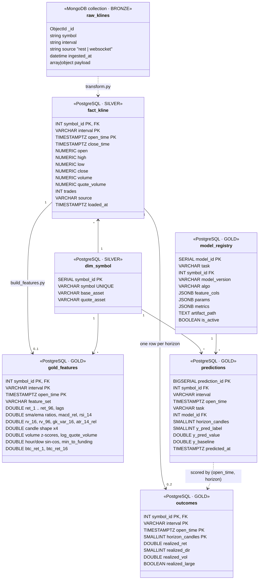

# OPA – Stage 1 Report: Data Discovery & Organization

**Project:** OPA – Crypto data pipeline and trading bot on Binance data
**Team:** Talgat Melisbekov, Dennis Secic
**Mentor:** Nicolas Fradin
**Stage deadline:** 19 October 2026

> Sections marked **TODO** still need input: real numbers and examples come from the first full run of the extractors.

---

## 1. Introduction

### 1.1 Context

**Technical.** Crypto exchanges produce market data around the clock, both as history (past candles) and as live streams. A trading bot or an analytics tool needs this data collected reliably, stored in a clean and queryable form, and kept up to date automatically. This is a typical Data Engineering problem: ingestion from an external API, storage in several layers, transformation, and later automation and serving through an API.

**Economic.** Binance is one of the largest cryptocurrency exchanges by trading volume. BTC/USDT and SOL/USDT are among its most liquid pairs, which means prices are meaningful and data is available continuously. Decisions based on market data (trading, risk monitoring, reporting) are only as good as the pipeline that delivers the data.

**Scientific.** Predicting short-term price movements is a hard problem; markets are noisy and close to random on short horizons. In this project the model is deliberately simple. The focus is on the data architecture that makes training, prediction and monitoring possible on fresh data.

### 1.2 Objectives

1. Collect historical and live candlestick (OHLCV) data for BTCUSDT and SOLUSDT from the Binance API
2. Store raw data unchanged (bronze) and clean, typed, deduplicated data (silver) in two different databases (NoSQL + relational)
3. Prepare a gold layer for features and model predictions (Stage 2)
4. Design the pipeline so it can run repeatedly and automatically without duplicates (Stage 3)

### 1.3 Team and expertise

| Member | Background | Main responsibilities in Stage 1 |
|---|---|---|
| Talgat Melisbekov | Data Engineer / BI Specialist (Python, SQL, data warehousing, BI), M.Sc. Informatics; active crypto investor | Repo setup, Docker environment, PostgreSQL schema, Mongo → Postgres transformation, UML diagrams |
| Dennis Secic | **TODO (Dennis):** short background | Binance REST and WebSocket extraction into MongoDB, API part of this report |

### 1.4 Similar projects

Two earlier DataScientest cohorts built OPA projects that we reviewed for inspiration:
- One team used the same Binance REST + WebSocket sources with MongoDB, Kafka, Airflow, FastAPI and Dash.
- Another team used the CoinGecko API with PostgreSQL only, storing historical and streaming data in separate tables.

Our approach combines both ideas and adds an explicit **bronze / silver / gold** layering: raw data is kept in MongoDB, cleaned data in PostgreSQL, and one transformation step connects them.

---

## 2. Data sources

### 2.1 Binance REST API (historical data)

**TODO (Dennis):**
- Endpoint: `GET https://api.binance.com/api/v3/klines`
- Parameters used: `symbol`, `interval=15m`, `startTime`, `endTime`, `limit=1000`
- Limits: max 1000 candles per request, request weight / rate limits
- Pagination strategy: next `startTime` = close time of the last candle (it ends in .999 ms, so the next request starts exactly at the next candle)
- Real example of one kline (copy from Mongo after the first run)

Each REST kline is an array with a fixed field order:

| Index | Field | Example type |
|---|---|---|
| 0 | Open time (ms) | integer |
| 1–4 | Open, High, Low, Close | string (decimal) |
| 5 | Volume (base asset) | string |
| 6 | Close time (ms) | integer |
| 7 | Quote asset volume (USDT) | string |
| 8 | Number of trades | integer |
| 9–10 | Taker buy base / quote volume | string |
| 11 | Unused | string |

### 2.2 Binance WebSocket API (live data)

**TODO (Dennis):**
- Stream: `wss://stream.binance.com:9443/stream?streams=btcusdt@kline_1m/solusdt@kline_1m`
- Message structure (`{"stream": ..., "data": {..., "k": {...}}}`), meaning of `k.x` (candle closed)
- How reconnects are handled
- Real example of one message (copy from Mongo after the first run)

### 2.3 Availability and ownership

The data is publicly available through Binance's market data endpoints; no API key is needed for klines. The data belongs to Binance and is used here for educational purposes.

### 2.4 Volume

| Data set | Interval | Period | Expected candles per symbol | Actual (TODO after first run) |
|---|---|---|---|---|
| REST history | 15m | ~180 days | 180 × 96 ≈ 17,280 | TODO |
| WebSocket live | 1m | continuous | 1,440 per day | TODO |

With two symbols, the historical load is about 35,000 candles: small in size, but enough to design and test a pipeline that would scale to more symbols and longer periods.

---

## 3. Data architecture

Full diagrams: [architecture.md](architecture.md) (data flow: `data_flow.png`, data model: `data_model.png`).



### 3.1 Why bronze / silver / gold

| Layer | Storage | Content | Reason |
|---|---|---|---|
| Bronze | MongoDB, collection `raw_klines` | Binance responses exactly as received + metadata | REST (array) and WebSocket (object) payloads have different shapes; a schema-less store keeps both unchanged. If a bug is found in the transformation, everything can be reprocessed without calling the API again. |
| Silver | PostgreSQL, `fact_kline` + `dim_symbol` | One clean, typed row per candle for all symbols and intervals | Fixed schema, a primary key that prevents duplicates, and SQL for joins and aggregations. |
| Gold | PostgreSQL, `gold_features` + `predictions` | Model features and predictions (Stage 2) | Ready-to-serve tables that FastAPI and Streamlit read directly. |

This also covers the Stage 1 requirement to use both a NoSQL and a relational database, each where it fits best.

### 3.2 Bronze document format

Both extractors write the same document structure, which is the contract between the extraction and transformation steps:

| Field | Type | Description |
|---|---|---|
| `symbol` | string | e.g. `BTCUSDT` |
| `interval` | string | `15m` (REST) or `1m` (WebSocket) |
| `source` | string | `rest` or `websocket` |
| `ingested_at` | datetime (UTC) | when the document was stored |
| `payload` | array / object | raw kline as received |

### 3.3 Relational model



- **`dim_symbol`**: one row per trading pair (`symbol_id`, `symbol`, `base_asset`, `quote_asset`). Adding a new pair is a single insert.
- **`fact_kline`**: one row per candle. Primary key `(symbol_id, interval, open_time)`. Prices and volumes are stored as `NUMERIC` (exact decimals, no floating-point rounding).
- **`gold_features`**: one row per candle with engineered features and the target; same primary key as `fact_kline`.
- **`predictions`**: every model run is kept with `model_version` and `created_at`, so predictions can later be compared with what actually happened.

**How the data sets are linked:** bronze and silver share the business key `(symbol, interval, open_time)`. During transformation, `symbol` is mapped to `dim_symbol.symbol_id`, and all PostgreSQL tables reference `dim_symbol`.

---

## 4. Pre-processing (bronze → silver)

The transformation (`src/data/transform.py`) performs these steps:

1. **Parsing:** REST arrays are mapped by position, WebSocket objects by field name (`t`, `o`, `h`, `l`, `c`, `v`, `q`, `n`, `x`), into the same named columns.
2. **Type conversion:** millisecond timestamps become UTC `TIMESTAMPTZ`; price and volume strings become exact decimals (`Decimal` in Python, `NUMERIC` in PostgreSQL). Floats are avoided because they introduce rounding errors.
3. **Filtering open candles:** a candle whose close time is in the future (REST) or that is not yet closed (`x = false`, WebSocket) is skipped, because its values will still change.
4. **Deduplication:** the same candle can arrive from both sources or from repeated runs; only one row per `(symbol, interval, open_time)` is kept.
5. **Idempotent load:** rows are written with `INSERT ... ON CONFLICT DO UPDATE` (upsert). Running the transformation again never creates duplicates, which is required for scheduled runs in Stage 3.

No normalization or dimensionality reduction is done at this stage. Feature scaling, if needed, belongs to the modeling step in Stage 2.

**Testing:** five unit tests cover the parsing logic (REST, closed and open WebSocket candles, different message shapes, unfinished REST candles) and run automatically in GitHub Actions on every push.

---

## 5. Examples of collected data

**TODO (after the first full run):**
- One raw REST document from MongoDB `raw_klines`
- One raw WebSocket document from MongoDB `raw_klines`
- A few rows from `fact_kline` (SQL query + result)
- Row counts per symbol and interval:

```sql
SELECT s.symbol, f.interval, COUNT(*) AS candles,
       MIN(f.open_time) AS first_candle, MAX(f.open_time) AS last_candle
FROM fact_kline f
JOIN dim_symbol s USING (symbol_id)
GROUP BY s.symbol, f.interval
ORDER BY s.symbol, f.interval;
```

---

## 6. Limitations and next steps

**Current limitations**
- The transformation reads the whole bronze collection on every run. This is fine for the current volume; for scheduled runs it will be changed to process only new documents.
- Only two symbols are collected; the schema already supports more.
- Live data depends on a running WebSocket connection; gaps can be filled later from the REST API.

**Next steps (Stage 2, until 2 November)**
- **TODO (team decision):** ML or Dashboard path
- Feature engineering into `gold_features` (returns, moving averages, RSI, volatility, target)
- FastAPI endpoints for candles, statistics and predictions

---

## Appendix: code files

| File | Purpose |
|---|---|
| `docker-compose.yml` | Starts MongoDB and PostgreSQL locally |
| `sql/init.sql` | PostgreSQL schema (silver and gold tables) |
| `src/data/db.py` | Shared database connections |
| `src/data/extract_rest.py` | Binance REST → MongoDB (bronze) |
| `src/data/extract_ws.py` | Binance WebSocket → MongoDB (bronze) |
| `src/data/transform.py` | MongoDB → PostgreSQL (silver) |
| `src/data/seed_sample.py` | Sample bronze documents for testing |
| `tests/` | Unit tests run by GitHub Actions |
| `docs/architecture.md` | UML diagrams and design decisions |
